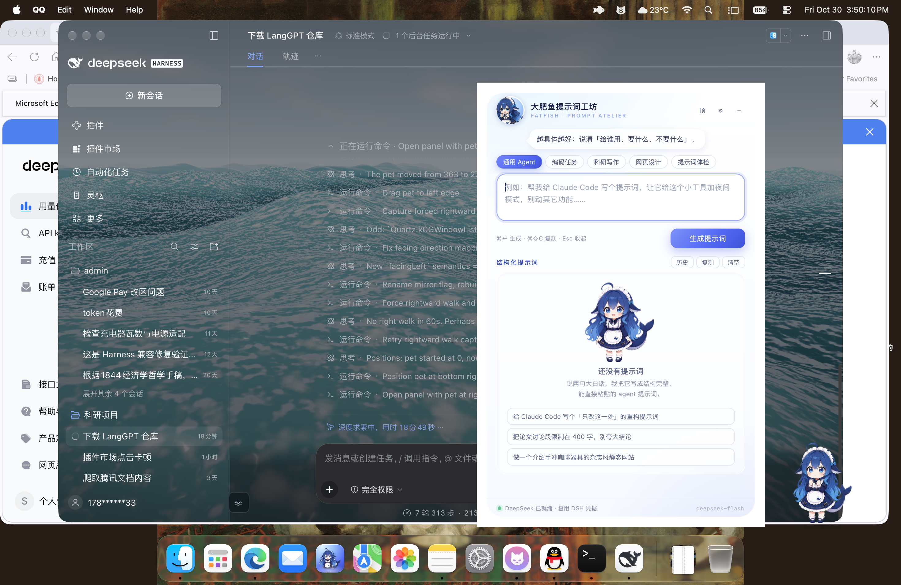
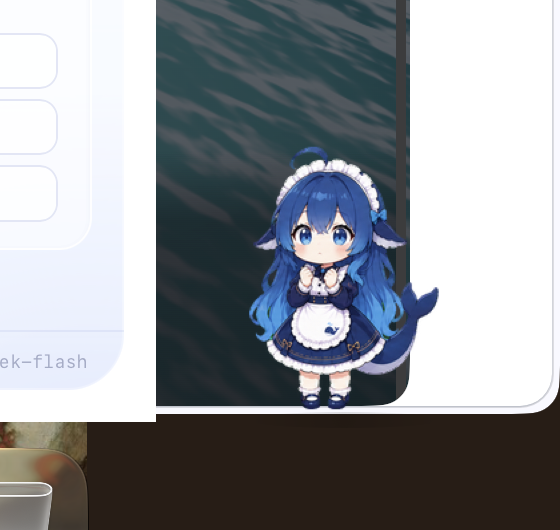
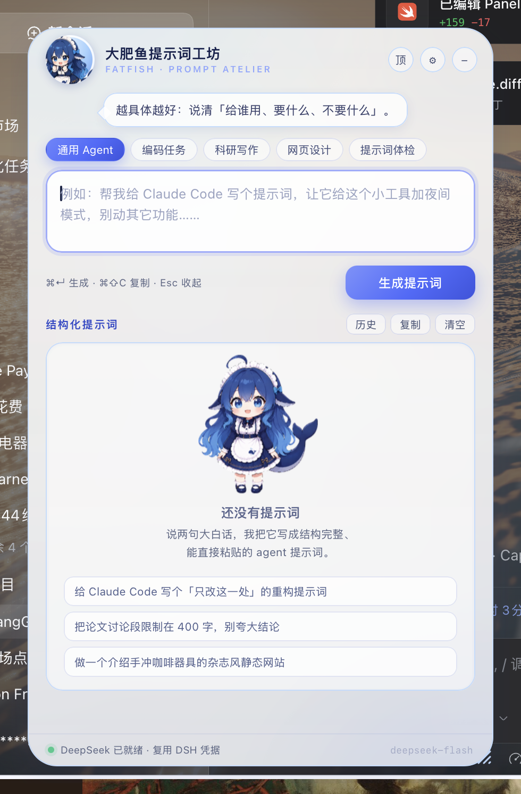
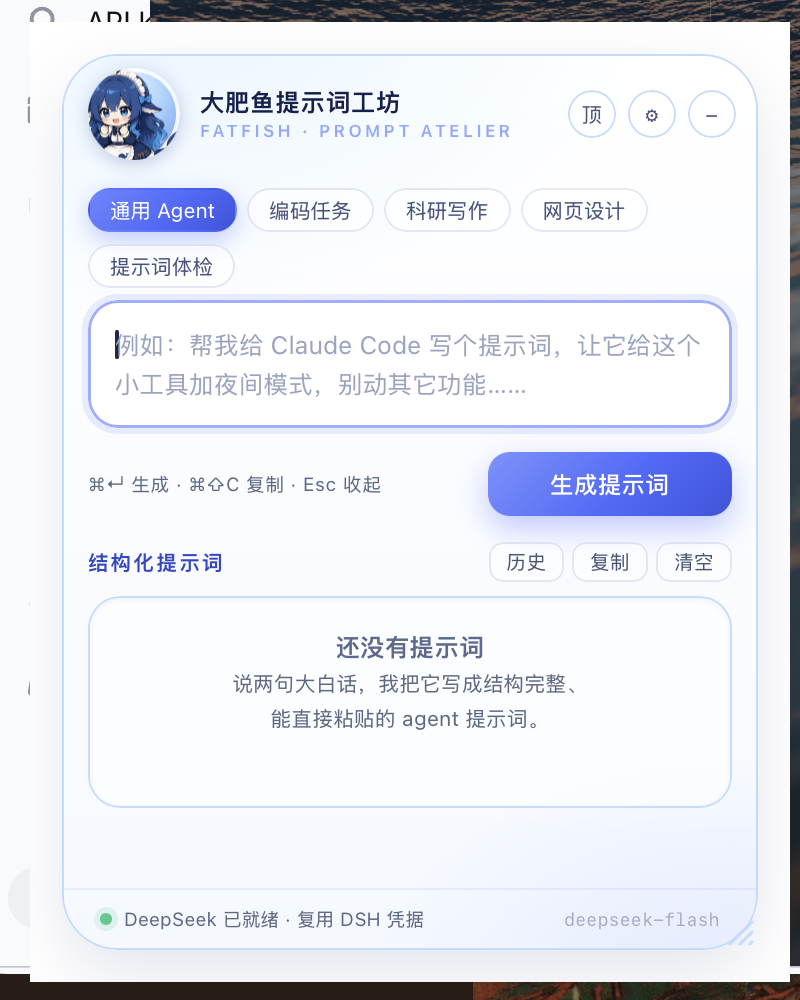
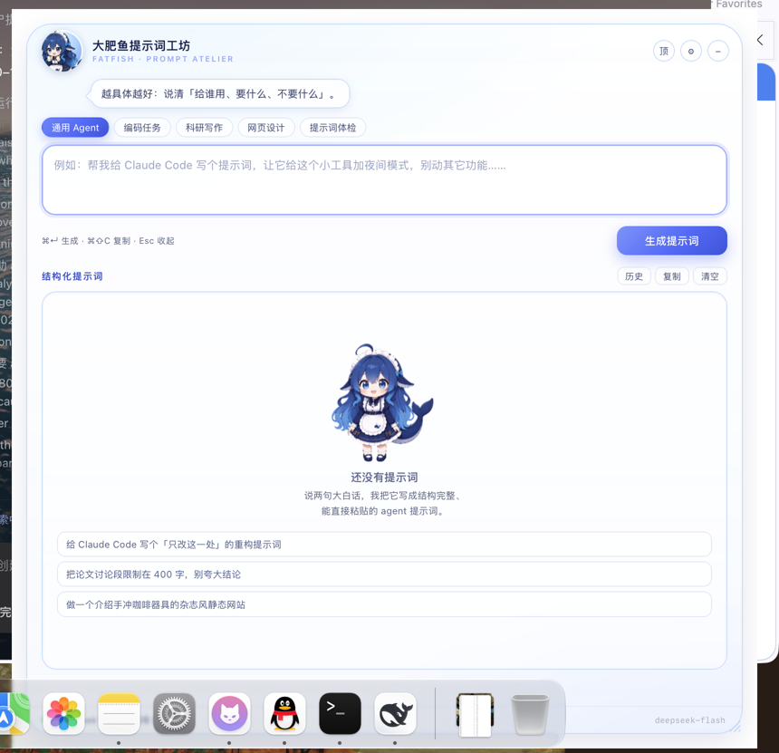

# 🐟 大肥鱼提示词工坊

> **2合1 合并版（v2.2）**：提示词工坊与 1080P 桌宠已合并为单个 App `大肥鱼.app`，桌宠作为 Python 子进程运行；架构、运行时补丁与验证清单见 [docs/2in1.md](docs/2in1.md)。

> **素材版权提示**：桌宠立绘与动画帧来自社区二创项目，版权归原作者，本项目仅作个人自用；仓库公开只为交流代码，**请勿商用或再分发素材**。完整出处与限制见 [SOURCES.md](SOURCES.md)。

把大白话变成 Agent 能直接执行的结构化提示词。形态参考 Codex 桌宠：**一只常驻桌面的大肥鱼**，戳一下才打开提示词工坊；她在写提示词时会坐到小桌前写字，写完吃口白饭。



| 桌宠 | 面板 |
| --- | --- |
|  |  |

## 用法

| 操作 | 效果 |
| --- | --- |
| 左键点大肥鱼 | 叫一声 + 探头反应，并打开 / 收起提示词工坊 |
| 右键大肥鱼 | 原生菜单：打开工坊 / 说句话 / 走两步 / 自由漫游 / 点击音效 / 查余额 / 隐藏 / 退出 |
| 拖动大肥鱼 | 换位置；快速甩出会带惯性滑行并撞边回弹 |
| 鼠标悬停 | 探头卖萌，偶尔冒一句台词 |
| 放着不管 | 每 16–34 秒自己决定：走两步、原地卖萌，或发呆 |
| `⌥⇧P` | 全局快捷键，随时呼出 / 收起面板 |
| 点 Dock 图标 | 打开提示词工坊（右键还有快捷菜单） |
| `⌘Q` | 退出整个 App（含桌宠） |
| `⌘↵` | 生成提示词 |
| `⌘⇧C` | 复制结果 |
| `Esc` | 收起面板 |

## 外观与尺寸

设置面板（⚙）里的「外观」区可以实时调卡片：

| 参数 | 控件 | 默认 | 范围 |
| --- | --- | --- | --- |
| 背景透明度 | 滑块 + 百分比 | 80% | 0–100% |
| 宽度 | 数值输入 / 拖右下角 | 470 pt | 380–1000 pt |
| 高度 | 数值输入 / 拖右下角 | 726 pt | 480–1000 pt |

- 卡片是 **28px 圆钝四角 + 1px 浅蓝描边** `#BFDBFE`，不再有纯白直角硬边；浅蓝描边不随透明度消失。
- 卡片外围的 16pt 留白必须是透明的：`WKWebView` 默认会在页面背后画一层白底（`underPageBackgroundColor` 管不到），关闭后白色直角框才彻底消失（`Sources/PanelWindow.swift` 里 KVC 到私有 `_setDrawsBackground:`，带 `responds` 守卫，缺该 API 的系统降级为白底并打日志）。
- 透明度只作用于背景层：`--pw-card-bg-opacity`。0% 时背景透明，但会保留一层白色文字底板（`--pw-card-scrim`）保证正文对比度 ≥ 4.5:1；不想要底板就把 `--pw-card-scrim` 设为 0。
- 尺寸会被夹到「最小/最大档」与当前屏幕可见区域两者之内，拖动后立即写进 `UserDefaults`，下次打开沿用。
- 小窗口（高 < 620pt）自动进入紧凑模式：模板 chip 换行、装饰插画和示例卡让位给输出区。

所有视觉参数都在 `Resources/panel/style.css` 顶部的 `:root` 里，改一行即可整体回退：

```css
--pw-card-border-color: #BFDBFE;
--pw-card-radius: 28px;
--pw-card-bg-opacity: 0.8;
--pw-card-scrim: 0;
--pw-card-width: 100%;
--pw-card-height: 100%;
```

| 小尺寸 380×480 | 大尺寸 823×816 |
| --- | --- |
|  |  |

面板里的 5 个模板（通用 Agent / 编码任务 / 科研写作 / 网页设计 / 提示词体检）只改变 system prompt 的补充约束；生成结果固定为 LangGPT 结构：

```
# Role / ## Profile / ## Background / ## Goals / ## Constraints
## Workflow / ## Output Format / ## Acceptance Criteria / ## Initialization
```

生成完可以继续点「更简洁 / 更严谨 / 补约束 / 重排结构」做二次精修；历史记录存在 localStorage，最近 20 条。

## 凭据

默认复用本机 DeepSeek Harness 已登录的凭据（只读 `~/.dsh/.credentials.yaml` 里的 `DEEPSEEK_API_KEY`，不写回、不外发）。也可以在面板 ⚙ 里填自己的 key（存 `UserDefaults`，优先于 DSH 凭据）。

模型：`deepseek-flash`，流式输出。

## 构建 / 运行

```bash
./build.sh --run        # 编译并打开
open build/大肥鱼提示词工坊.app
```

要求 macOS 13+，Xcode 命令行工具（swiftc）。产物是 ad-hoc 签名的常规 App：**Dock 有图标、⌘Tab 可见、Finder / Launchpad 双击可启动**，菜单栏另有一个 🐟 状态图标。

装到「应用程序」并固定到 Dock：

```bash
./安装到应用程序.command     # 复制到 /Applications → 固定 Dock → 启动
```

**单实例**：`LSMultipleInstancesProhibited` + `flock` 文件锁双重保护，重复启动（`open -n` 或直接跑二进制）会唤醒已运行的实例并打开面板，然后自己退出，不会出现第二只大肥鱼。点 Dock 图标 = 打开面板；右键 Dock 图标 = 快捷菜单（打开工坊 / 说句话 / 退出）。

自测（自动填一段需求、生成、复制、检查桌宠状态）：

```bash
./build/大肥鱼提示词工坊.app/Contents/MacOS/FatFishPrompt --demo
```

## 结构

```
Sources/
  PetWindow.swift     原生透明桌宠 + 像素命中 / 跨应用穿透 / 拖动
  PanelWindow.swift   磨砂卡片面板（NSVisualEffectView + WKWebView）
  Bridge.swift        JS ⇄ Swift 桥（生成、复制、状态、桌宠动作）
  DeepSeekClient.swift  SSE 流式请求
  Credentials.swift   DSH 凭据复用
  Hotkey.swift        Carbon 全局热键 ⌥⇧P
  Balance.swift       DeepSeek /user/balance 余额查询
Resources/
  pet/                真透明大肥鱼动画帧（含 walk）；pet.html 仅留作旧版参考
  panel/              面板 UI（index.html / style.css / app.js / presets.js）
```

桌宠动画由 5 组 WebP 帧驱动（均从官方 `deepseek-fat-fish` 图集裁成 192×208）：`fatfish-idle-*`（待机 6 帧）、`fatfish-hover-*`（悬停 5 帧）、`fatfish-working-*`（生成中 6 帧）、`fatfish-success-*`（完成 6 帧）、`fatfish-walk-*`（走路 8 帧；素材本身朝左，向右走时水平镜像）。`Bridge` 在生成开始 / 完成 / 报错时切换状态并弹气泡。

## 桌宠行为（v2.1，参考 dsh-pet-indesktop）

- **漫游**：每 16–34 秒掷骰 —— 走 52–150 pt 后停下，或原地探头卖萌；`自由漫游` 可在右键菜单关掉。
- **拖拽物理**：拖动时实时跟随；松手按最后几帧的速度滑行，指数衰减摩擦，撞到屏幕左右边缘回弹（×0.42），速度低于 26 pt/s 停住。
- **点击反馈**：短促音效（`NSSound("Tink")`，音量 0.12）+ 探头帧 + 偶发台词；透明像素处点击直接穿透。
- **状态机**：`idle / hover / working / success / walk` 五态；working 正在生成、success 完成、hover 由像素命中的指针进入驱动，外部状态会打断漫游。
- **余额**：右键「查 DeepSeek 余额」调官方 `/user/balance`，结果用气泡显示（余额 / 充值 / 赠送）。
- **@MainActor 安全**：所有窗口操作都回到主线程（网络回调里也会自动 hop 回主线程），避免 `NSWindow should only be instantiated on the main thread` 崩溃。

## 迷你桌宠修复（2026-10-30）

- 桌宠使用原生 AppKit 绘制，窗口为 **160×164 pt**，角色约 **128×139 pt**；没有常驻卡片底板。提示词工坊仍由 WebKit 提供。
- 角色透明轮廓外按图像 alpha 在窗口层穿透鼠标；拖动期间锁定接收，松手不误触打开。只保留轻薄接地阴影，待机以静止为主、偶尔眨眼，不持续缩放。
- 反馈气泡是独立的原生毛玻璃浮窗，只有任务反馈或主动“说句话”时出现，气泡本身不拦鼠标。
- 旧版位置只迁移角色的中心和脚底位置，不恢复旧的 240×310 大画布；拖动后即时保存，显示器变化时把窗口收回可见区域。面板跟随桌宠所在显示器。
- success/hover 的回退由同一个状态机处理，旧回调不会把下一次 working 动画重置掉。
- 尺寸与边距统一在 `Sources/PetWindow.swift` 的 `PetGeometry`；完整透明动画的提取方式见 `SOURCES.md` 与 `scripts/extract-pet-frames.py`。

## 美术素材来源

角色是 DeepSeek 的「大肥鱼 / 鲸鱼娘」社区二创形象，**仅个人使用**。素材出处见 [SOURCES.md](SOURCES.md)；同目录 `../大肥鱼皮肤源码/` 保存了检索到的全部开源皮肤 / 桌宠项目源码（含 MIT 项目与许可证说明）。
